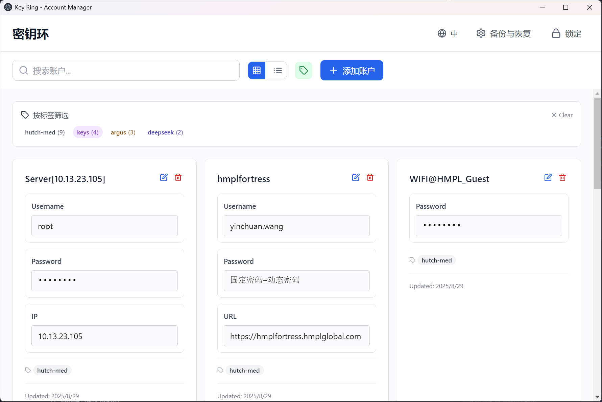
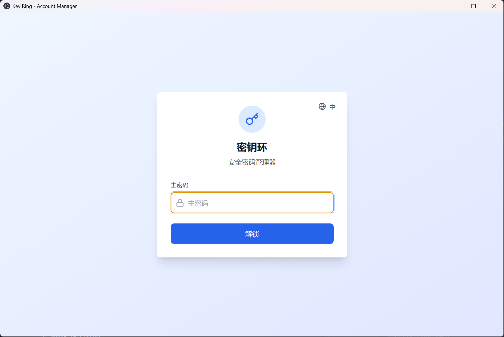
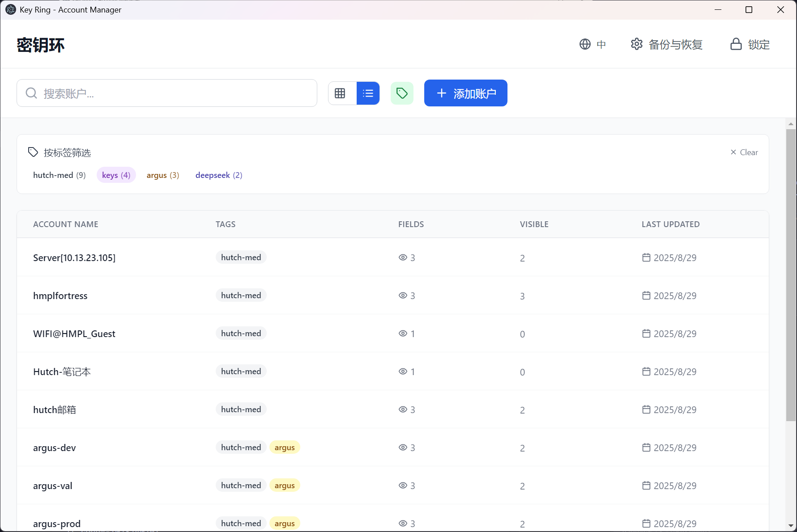
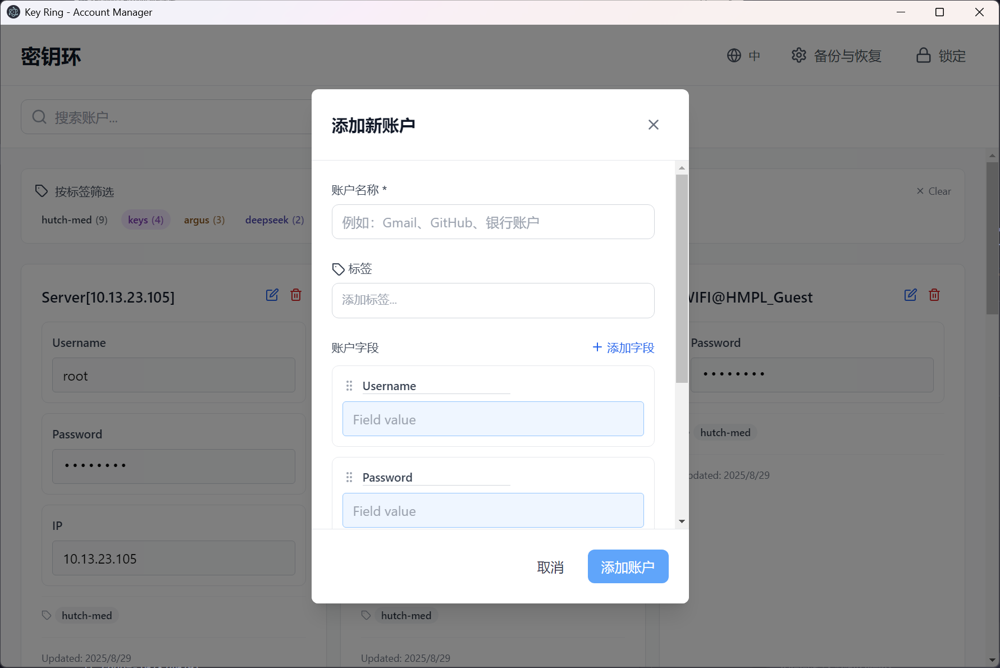
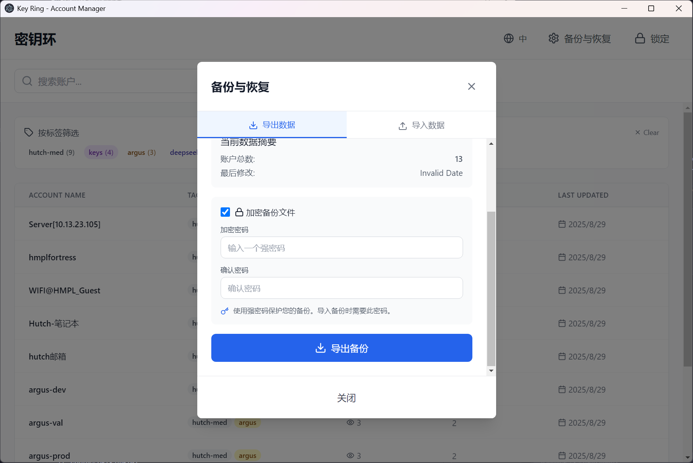
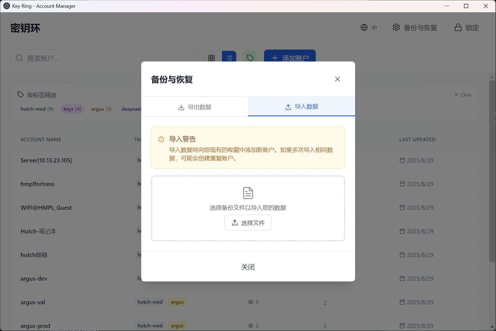

# Key Ring - 账户管理工具

<p align="center">
  🌐 <a href="README.md">English</a> · <strong>简体中文</strong> · <a href="https://456wyc.github.io/KeyRing/">项目主页</a>
</p>

<p align="center">
  
</p>

一个安全的跨平台桌面账户管理工具，基于 Electron、React 和 TypeScript 构建。

🔗 **仓库地址**：https://github.com/456wyc/KeyRing · 🌐 **项目主页**：https://456wyc.github.io/KeyRing/

## ✨ 功能特性

### 🔒 安全与认证
- 🔐 **安全存储**: 使用主密码进行 AES 加密
- 🔑 **主密码保护**: 基于 PBKDF2 的认证机制
- 🔁 **主密码管理**: 随时修改、取消或重新启用主密码
- 💾 **数据备份**: 支持导出/导入数据备份
- 🛡️ **本地存储**: 数据完全本地化，无云端依赖

### 📊 账户管理
- ➕ **自定义字段**: 为每个账户添加任意字段
- 🏷️ **多标签系统**: 支持多标签分类和筛选
- 📋 **一键复制**: 一键复制任何字段值到剪贴板
- ✏️ **编辑保护**: 显式编辑模式防止意外修改
- 🔍 **智能搜索**: 支持按名称和字段内容搜索
- 📱 **双布局视图**: 卡片视图和列表视图自由切换

### 🎲 密码功能
- 🔄 **随机密码生成**: 可自定义规则的密码生成器
- ⚙️ **自定义规则**: 每个账户可设置独立的密码生成规则
- 👁️ **密码显示**: 切换密码可见性
- 🎯 **智能识别**: 自动识别密码字段

### 🌍 用户体验
- 🌐 **双语支持**: 中英文界面切换
- 🎨 **标签颜色**: 基于哈希的一致性标签颜色
- 📱 **响应式设计**: 适配不同屏幕尺寸
- 🖥️ **跨平台**: 支持 Windows、macOS 和 Linux

## 🚀 快速开始

### 方法1: 直接运行 (推荐)

1. **克隆仓库**:
   ```bash
   git clone https://github.com/456wyc/KeyRing.git
   cd KeyRing
   ```

2. **安装依赖**:
   ```bash
   npm install
   ```

3. **运行应用**:
   ```bash
   npm run start
   ```
   
   或直接双击 \`run.bat\` 文件 (Windows)

### 方法2: 开发模式

```bash
npm run dev
```

这将同时启动 Vite 开发服务器和 Electron。

## 📸 界面截图

### 主密码解锁


### 账户管理（卡片视图）


### 账户管理（列表视图）


### 添加账户


### 备份与恢复（导出）


### 备份与恢复（导入）


## 📦 打包问题解决方案

如果遇到打包错误（符号链接权限问题），可以使用以下解决方案：

### 临时解决方案
1. 使用 \`npm run start\` 或 \`run.bat\` 直接运行
2. 应用功能完全正常，只是没有安装包

### 打包解决方案
1. **以管理员身份运行命令提示符**
2. **启用开发者模式**：
   - 设置 → 更新和安全 → 开发者选项 → 开发人员模式
3. **或者修改配置**：
   ```bash
   npm install electron-builder@latest
   npm run package:win
   ```

### 网络问题（下载失败）

electron-builder 打包时需要从 GitHub 下载 Electron 二进制包，网络不通会报
`EOF` / `ERR_ELECTRON_BUILDER_CANNOT_EXECUTE`。此时改用国内镜像打包：

```bash
npm run package:win:cn
```

该脚本将 Electron 二进制指向 npmmirror，并通过 `ELECTRON_BUILDER_BINARIES_MIRROR`
把 winCodeSign / NSIS 资源一并走镜像。`package.json` 中也已配置：

```json
"electronDownload": { "mirror": "https://npmmirror.com/mirrors/electron/" }
```

## 🎯 使用指南

### 首次使用
1. 启动应用后会要求创建主密码
2. 设置一个强密码（无法恢复，请牢记）
3. 进入主界面

### 主密码管理
1. 点击右上角"修改主密码"
2. **修改**：验证当前主密码后设置新密码（数据将自动重新加密）
3. **取消**：验证当前主密码后可取消密码保护
4. **启用**：取消保护后可在同一弹窗中重新设置主密码

### 添加账户
1. 点击 "Add Account" 按钮
2. 输入账户名称
3. 添加标签：输入标签名称，支持自动补全现有标签
4. 添加/修改字段：
   - 预设字段：用户名、密码、邮箱、网址
   - 可以添加任意自定义字段
   - 可以重命名或删除字段
   - 支持拖拽排序

### 标签管理
- **添加标签**：在账户编辑时输入标签名称
- **标签筛选**：点击标签切换按钮显示标签筛选器
- **多选筛选**：可同时选择多个标签进行筛选
- **标签颜色**：每个标签自动分配一致的颜色
- **显示控制**：可以切换标签的显示和隐藏

### 视图模式
- **卡片视图**：网格布局，显示账户详细信息
- **列表视图**：表格布局，便于快速浏览
- **布局切换**：点击工具栏中的网格/列表图标

### 密码生成
1. **随机密码**：点击字段旁的设置图标
2. **自定义规则**：长度、字符类型、排除字符等
3. **智能识别**：自动识别密码字段并提供生成选项

### 搜索与筛选
- **文本搜索**：使用顶部搜索框按名称和字段内容搜索
- **标签筛选**：按标签筛选账户
- **组合筛选**：搜索和标签筛选可同时使用

### 数据管理
- **数据备份**：点击"备份与恢复"按钮导出数据
- **数据恢复**：选择备份文件导入账户数据
- **安全性**：备份文件为JSON格式，包含元数据和版本信息

### 多语言
- **语言切换**：点击右上角语言切换按钮
- **支持语言**：中文简体、English
- **界面适配**：所有界面元素完整翻译

### 安全功能
- **锁定**：点击右上角 "Lock" 按钮
- **自动锁定**：关闭应用时自动锁定
- **密码隐藏**：密码字段默认隐藏，点击眼睛图标显示

## 🔒 安全说明

- 所有数据本地存储在 \`~/.keyring\` 目录
- 使用 AES-256 加密
- 主密码通过 PBKDF2 (100,000 次迭代) 进行哈希
- 加密密钥安全派生且不以明文存储
- 无网络依赖，数据不上传云端

## 📁 文件结构

```
key-ring/
├── src/                    # React 前端源码
│   ├── components/         # UI 组件
│   │   ├── AccountCard.tsx       # 账户卡片组件
│   │   ├── AccountManager.tsx    # 主管理界面
│   │   ├── AccountListView.tsx   # 列表视图
│   │   ├── BackupRestore.tsx     # 备份恢复组件
│   │   ├── TagInput.tsx          # 标签输入组件
│   │   ├── TagFilter.tsx         # 标签筛选组件
│   │   └── ...                   # 其他组件
│   ├── i18n/              # 国际化
│   │   ├── en.ts          # 英文翻译
│   │   ├── zh.ts          # 中文翻译
│   │   └── types.ts       # 翻译类型定义
│   ├── styles/            # 样式文件
│   └── types.ts           # TypeScript 类型定义
├── electron/              # Electron 主进程
│   ├── main.ts           # 主进程入口
│   ├── preload.ts        # 预加载脚本
│   └── storage.ts        # 加密存储
├── _doc/                 # 项目文档
├── docs/                 # GitHub Pages 宣传页
│   ├── index.html        # 项目落地页
│   └── screenshots/      # 落地页使用的截图
├── snapshots/            # README 使用截图
├── dist/                 # 构建输出
└── run.bat              # Windows 启动脚本
```

## 🌐 GitHub Pages

项目宣传页位于 `docs/` 目录，发布步骤：

1. 将本仓库推送到 GitHub
2. 打开 **Settings → Pages**
3. **Source** 选择 *Deploy from a branch*，分支选 `main`，目录选 `/docs`
4. 访问 **https://456wyc.github.io/KeyRing/** 即可查看宣传页

宣传页支持中英文切换、功能总览与截图画廊。

## ❓ 常见问题

**Q: 忘记主密码怎么办？**
A: 主密码无法恢复，建议定期备份重要账户信息到其他安全位置。

**Q: 数据存储在哪里？**
A: 数据存储在用户主目录的 \`.keyring\` 文件夹中，已加密。

**Q: 为什么打包失败？**
A: Windows 符号链接权限问题，使用 \`npm run start\` 直接运行即可。

**Q: 如何备份数据？**
A: 有两种备份方式：
1. **应用内备份**：点击"备份与恢复"按钮，导出JSON格式的备份文件
2. **文件夹备份**：复制 \`~/.keyring\` 文件夹到安全位置（需要主密码才能解密）

**Q: 如何恢复数据？**
A: 使用"备份与恢复"功能导入之前导出的JSON备份文件，系统会自动验证数据完整性。

## 🌐 文档语言

- [English](README.md) — 英文文档
- **简体中文** — 当前文档

## 📄 许可证

MIT License - 详见 LICENSE 文件